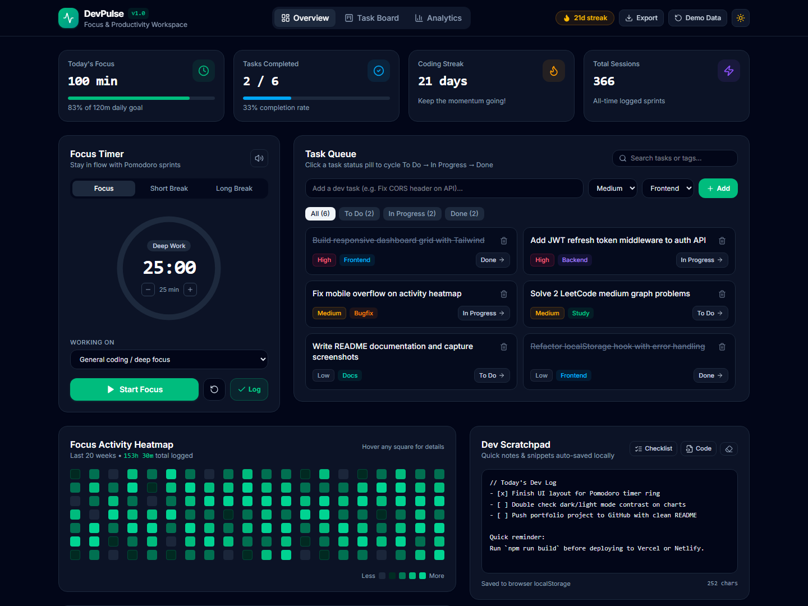
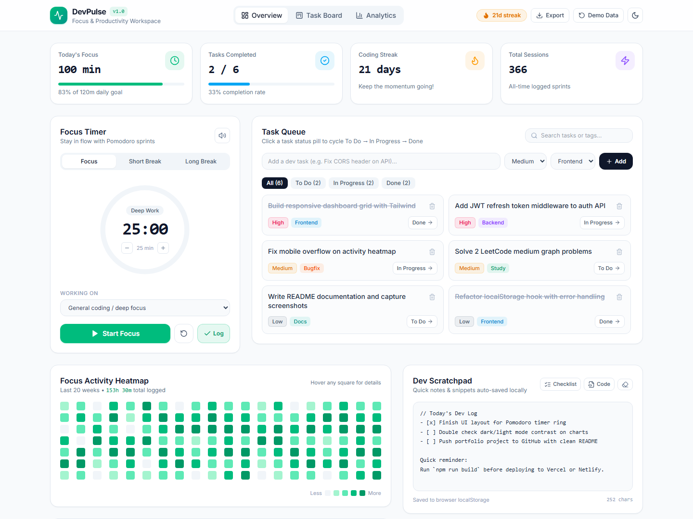
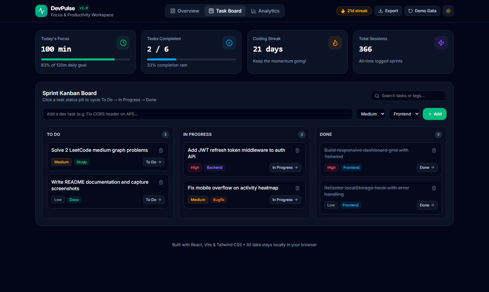
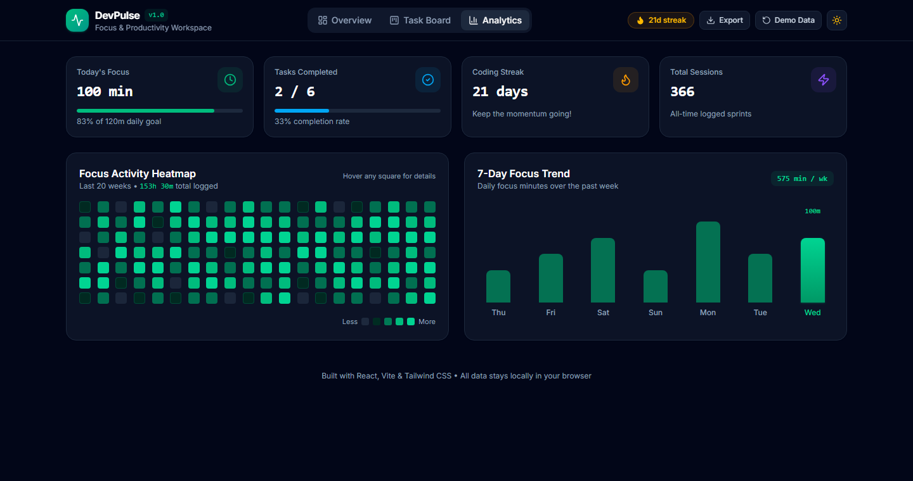

# ⚡ DevPulse — Developer Focus & Productivity Workspace


**DevPulse** is a distraction-free productivity dashboard designed for developers and CS students. It brings together a Pomodoro focus timer, a sprint task queue / Kanban board, a GitHub-style 20-week focus activity heatmap, a 7-day focus trend chart, and a persistent dev scratchpad — all running locally in your browser with zero backend setup.

---

## 📸 Screenshots

### Overview Dashboard (Dark Mode)


### Overview Dashboard (Light Mode)


### Sprint Kanban Board


### Focus Analytics & Activity Heatmap


---

## ✨ Key Features

- **Pomodoro Focus Timer**
  - Switch smoothly between **Focus (25m)**, **Short Break (5m)**, and **Long Break (15m)** modes.
  - Adjust sprint duration (`-5m` / `+5m`), link a session to an active task, and track progress on an animated SVG ring.
  - Built-in **Web Audio API** completion chime (no external audio files required) and live countdown in the browser tab title.
- **Task Queue & 3-Column Kanban Board**
  - Add tasks with **Priority** (`High`, `Medium`, `Low`) and **Category Tags** (`Frontend`, `Backend`, `Bugfix`, `Study`, `Docs`).
  - Filter by status or search in real time, cycle task status (`To Do` → `In Progress` → `Done`) in one click, or switch to the full Kanban view.
- **20-Week Coding Activity Heatmap & 7-Day Trend Chart**
  - GitHub-inspired contribution grid showing daily focus intensity across the past 140 days with interactive hover tooltips.
  - Weekly bar chart displaying daily logged minutes and current coding streak calculation.
- **Dev Scratchpad**
  - Persistent scratchpad for quick debugging notes, daily checklists, or code snippets with 1-click template insertion.
- **Zero-Setup Persistence & Backup**
  - Automatically saves tasks, notes, theme preference, and focus history to `localStorage`.
  - Includes **Demo Data** reset for instant showcase testing and **Export JSON** to download a full workspace backup.
- **Dark & Light Themes**
  - Responsive Bento-style layout supporting both sleek dark mode and high-contrast light mode.

---

## 🛠️ Tech Stack

| Category | Technology |
| --- | --- |
| **Frontend Library** | React 19 (Functional Components & Hooks) |
| **Build Tool** | Vite 6 |
| **Styling** | Tailwind CSS v4 |
| **Icons** | Lucide React |
| **Audio Alerts** | Browser Web Audio API |
| **Persistence** | `window.localStorage` via custom `useLocalStorage` hook |

---

## 📁 Project Structure

```text
devpulse/
├── docs/
│   └── screenshots/          # UI documentation screenshots
│       ├── analytics-dark.png
│       ├── dashboard-dark.png
│       ├── dashboard-light.png
│       └── kanban-board.png
├── src/
│   ├── components/
│   │   ├── ActivityHeatmap.jsx   # 20-week contribution heatmap grid
│   │   ├── FocusTimer.jsx        # SVG ring Pomodoro timer + task linker
│   │   ├── Navbar.jsx            # Navigation tabs, streak badge, theme & export
│   │   ├── QuickNotes.jsx        # Persistent developer scratchpad
│   │   ├── StatsRow.jsx          # 4 summary metric cards with goal bars
│   │   ├── TaskBoard.jsx         # Compact task queue & 3-column Kanban board
│   │   └── WeeklyChart.jsx       # 7-day focus minutes bar chart
│   ├── data/
│   │   └── demoData.js           # Sample tasks, notes, and 140-day activity seed
│   ├── hooks/
│   │   └── useLocalStorage.js    # Reusable hook for state persistence
│   ├── utils/
│   │   ├── dateHelpers.js        # Date formatting, streak & chart data helpers
│   │   └── sound.js              # Web Audio API chime generator
│   ├── App.jsx                   # Main workspace state and layout
│   ├── index.css                 # Tailwind v4 entry & custom scrollbar styles
│   └── main.jsx                  # React root entry point
├── index.html
├── package.json
├── vite.config.js
└── LICENSE
```

---

## 🚀 Getting Started

### Prerequisites
- [Node.js](https://nodejs.org/) (v18 or higher recommended)
- `npm` (comes with Node.js)

### Installation

1. **Clone the repository**
   ```bash
   git clone https://github.com/alijufry/devpulse.git
   cd devpulse
   ```

2. **Install dependencies**
   ```bash
   npm install
   ```

3. **Start the development server**
   ```bash
   npm run dev
   ```
   Open the local URL shown in your terminal (typically `http://localhost:5173`).

4. **Build for production**
   ```bash
   npm run build
   npm run preview
   ```

---

## 💡 What I Learned Building This

- Managing interconnected React state cleanly without external state libraries (`useState`, `useEffect`, `useMemo`).
- Building a custom `useLocalStorage` hook with lazy initialization and JSON parse error handling.
- Calculating SVG circular progress geometry (`stroke-dasharray` / `stroke-dashoffset`) for the Pomodoro timer.
- Computing consecutive-day streaks and rolling 140-day date grids in plain JavaScript without heavy date libraries.
- Synthesizing notification chimes directly with the browser's `AudioContext` API.

---

## 🗺️ Roadmap

- [ ] Drag-and-drop cards on the 3-column Kanban board
- [ ] Customizable daily focus goal (currently 120 min)
- [ ] Import workspace backup from JSON file
- [ ] Optional GitHub OAuth / cloud sync

---

## 📄 License

This project is licensed under the [MIT License](LICENSE).

---

> Made with ☕ and focus — feel free to fork, star, or customize it for your own workflow!
